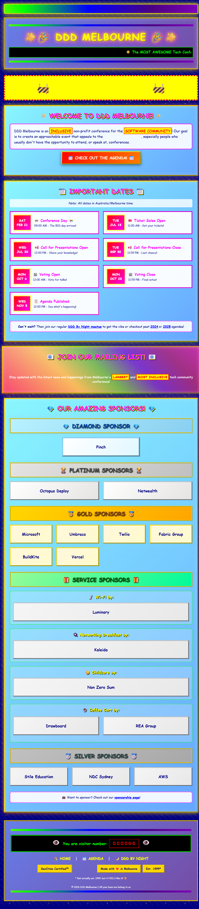
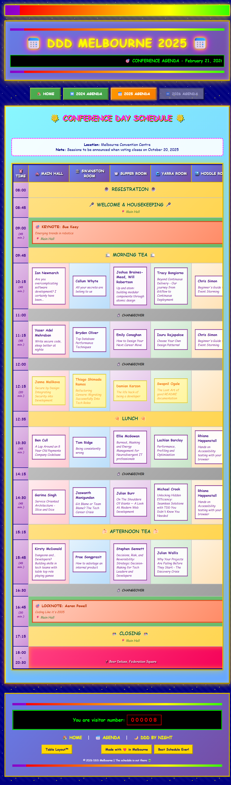

# 🌟 DDD Melbourne - 90s Geocities Edition 🌟

> _Best viewed in Netscape Navigator 4.0+_

A **vibe coded** reimagining of the [DDD Melbourne](https://www.dddmelbourne.com/) conference website — as if it were built in the golden age of GeoCities, circa 1997. Every design choice is intentionally chaotic, gloriously animated, and dripping with 90s nostalgia.

This entire site was vibe coded with GitHub Copilot as a fun demo for the DDD Melbourne 2025 conference.




## ✨ Features

- 🌌 **Animated starfield background** — because space is cool
- 🌈 **Rainbow gradient headers** — taste the rainbow
- 📜 **`<marquee>` scrolling text** — as the web gods intended
- 💥 **Blinking text** — a true GeoCities staple
- 👀 **Working visitor counter** — stored server-side in a text file
- 🔤 **Comic Sans MS everywhere** — deliberately, lovingly chosen
- 🚧 **"Under Construction" signs** — perpetually
- 🐿️ **Flying squirrel animation** — why not?
- 🦄 **Narwhal, unicorn & dark mode easter eggs** — hidden surprises
- 🎹 **MIDI soundtrack** — auto-generated, authentically awful
- 🎮 **Konami Code easter egg** — `↑ ↑ ↓ ↓ ← → ← → B A`
- ✨ **Random sparkle effects** — for that extra magical touch
- 📅 **Full conference agenda** — with real session data from DDD Melbourne 2025

## 🎯 Tech Stack

- **Runtime**: Node.js + Express
- **Frontend**: HTML, CSS, Vanilla JS — no build step, no frameworks, no nonsense
- **MIDI Generation**: Python script using `midiutil`
- **Agenda Scraping**: Python script to pull session data from Sessionize
- **Vibes**: 100% GitHub Copilot

## 🚀 Getting Started

```bash
# Install dependencies
npm install

# Start the server
npm start
```

Then open [http://localhost:3001](http://localhost:3001) and prepare your eyeballs.

## 📁 Project Structure

```
dddmelb-retro/
├── public/
│   ├── index.html          # Main homepage
│   ├── agenda.html         # Conference agenda page
│   ├── styles.css          # Retro styles (the big one)
│   ├── agenda-styles.css   # Agenda-specific styles
│   ├── script.js           # Sparkles, counters & effects
│   ├── midi-synth.js       # In-browser MIDI playback
│   ├── darkmode.js         # Dark mode toggle (lol)
│   ├── narwhal.js          # 🐳 Narwhal easter egg
│   ├── unicorn.js          # 🦄 Unicorn easter egg
│   ├── adware.js           # Fake 90s popup ads
│   └── ddd-theme.mid       # Auto-generated MIDI soundtrack
├── server.js               # Express server + visitor counter
├── generate_midi.py        # Python script to generate the MIDI file
├── ddd_agenda.py           # Python script to scrape agenda from Sessionize
├── visitors.txt            # Visitor counter persistence
└── package.json
```

## 🎵 Generating the MIDI Soundtrack

```bash
pip install midiutil
python generate_midi.py
```

## 📝 License

[MIT](LICENSE) — feel free to use this for your own retro websites!

## 🎉 Fun Facts

- No actual GIF files were harmed — we use SVG emojis and pure CSS animations
- Every colour was carefully chosen to clash beautifully
- The visitor counter _actually works_
- There's a fake "adware" popup system because authenticity matters
- The MIDI file was generated with Python, not by hand

---

Made with ❤️, vibes, and a heavy dose of 90s nostalgia for [DDD Melbourne](https://www.dddmelbourne.com/).

*All your base are belong to us.*
